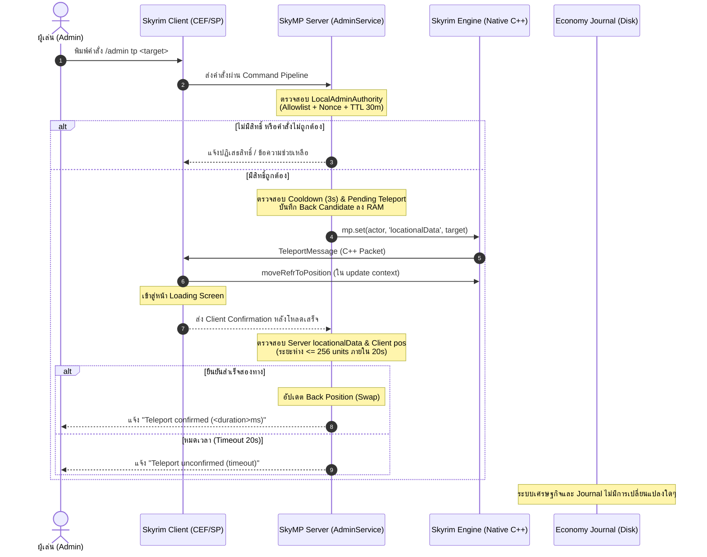
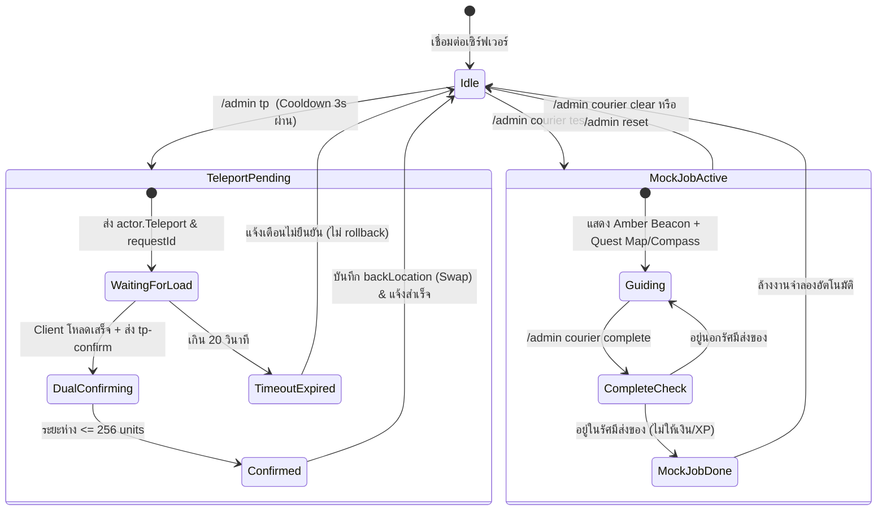

# แผนงานระบบคำสั่งแอดมินสำหรับวาร์ปและทดสอบ Courier (Frostveil RP)

> [!IMPORTANT]
> **หลักการสถาปัตยกรรมสำหรับเกมออนไลน์ (Online Game Architecture):** 
> 1. ฝั่งเซิร์ฟเวอร์มีอำนาจตัดสินใจสูงสุด (Server-Authoritative) ไม่เชื่อถือข้อมูลดิบหรือพิกัดจาก Client
> 2. แยกหน่วยความจำของงานจำลอง (Strict Memory Isolation) ไม่แตะต้องระบบเศรษฐกิจ บัญชี เงิน หรือค่า XP จริง
> 3. ตรวจสอบยืนยันผลสองทาง (Dual-Confirmation) ก่อนรับรองความสำเร็จของการวาร์ป
> 4. ป้องกัน Engine Crash หลังการเปลี่ยนพื้นที่ โดยตัดวงจรการเข้าถึง Native References ของ NPC ที่ถูกลบ

---

## 1. ภาพรวมสถาปัตยกรรมและความปลอดภัย (System Architecture & Security)

### 1.1 ลำดับการทำงานและการแบ่งขอบเขตความปลอดภัย (Trust Boundaries)



### 1.2 กฎความปลอดภัยที่เข้มงวด
* **Self-Target Only:** ทุกคำสั่งจัดการเฉพาะตัวละครของผู้ส่งคำขอ (`ctx.actorId`) เท่านั้น ไม่มีฟังก์ชันวาร์ปผู้เล่นอื่นหรือรันคำสั่ง Console ทั่วไป
* **Whitelist-Only Destinations:** ปลายทางทั้งหมดถูกฮาร์ดโค้ดและตรวจสอบบน Master ESM แล้ว ไม่รับพิกัด `X, Y, Z`, Cell Name หรือ Form ID จากคำสั่งของผู้เล่น
* **Replay & Generation Protection:** ทุกคำขอวาร์ปจะสร้าง `requestId` (UUID) ผูกกับ `sessionGeneration` หากผู้เล่นหลุดการเชื่อมต่อหรือเปลี่ยนตัวละคร Callback เก่าจะถูกยกเลิกทันที
* **Single In-Flight & Cooldown:** อนุญาตคำขอวาร์ปครั้งละ 1 รายการต่อตัวละคร พร้อม Cooldown 3 วินาที ปฏิเสธทันทีหากกำลังโหลด, ตาย, อยู่ในสภาวะ Ragdoll หรือมีคำขอวาร์ปค้างอยู่

---

## 2. ตารางข้อกำหนดคำสั่งแอดมิน (Admin Commands Specification)

| คำสั่ง | พารามิเตอร์ | การทำงาน | ข้อยกเว้น / ข้อความแจ้งเตือน |
|---|---|---|---|
| `/admin help` | - | แสดงรายการคำสั่งแอดมินทั้งหมดพร้อมตัวอย่าง | - |
| `/admin where` | - | อ่านตำแหน่งเต็มจาก `locationalData` แสดง `Cell/World`, `XYZ` (ทศนิยม 2 ตำแหน่ง), และมุมหมุน `Rot` | หากอ่านไม่ได้ แจ้งข้อผิดพลาดทางเทคนิค |
| `/admin tp list` | - | แสดงรายชื่อจุดวาร์ป Whitelist ทั้งหมดที่ระบบรองรับ | - |
| `/admin tp pickup` | - | วาร์ปไปจุดรับงาน Rift Watchtower (`3c:Skyrim.esm`) | ปฏิเสธหากติด Cooldown หรือมีคำขอค้าง |
| `/admin tp delivery` | - | วาร์ปไปปลายทาง Courier ปัจจุบัน โดย**เลือกงานจำลองก่อน** หากไม่มีงานจำลองจึงเลือกงานจริง | ปฏิเสธหากไม่มีทั้งงานจำลองและงานจริง |
| `/admin tp <routeId>` | `courier-route-1`<br>`sarethi-farm`<br>`heartwood-mill`<br>`merryfair-farm`<br>`shors-stone` | วาร์ปไปปลายทางของหนึ่งใน 5 เส้นทาง Courier ที่กำหนด | ปฏิเสธหากระบุ Route ID ไม่ถูกต้อง |
| `/admin tp navtest` | - | วาร์ปไปจุดทดสอบ The Bee and Barb (Riften Interior `16bdf:Skyrim.esm`) | - |
| `/admin back` | - | วาร์ปกลับจุดก่อนหน้าการวาร์ปสำเร็จครั้งล่าสุด โดยเมื่อวาร์ปสำเร็จจะ**สลับตำแหน่ง (Swap)** เพื่อให้กดกลับไปกลับมาได้ | ปฏิเสธหากยังไม่มีประวัติการวาร์ปสำเร็จในเซสชันนี้ |
| `/admin courier test <routeId>` | `courier-route-1` .. `shors-stone` | เปิดงานจำลอง Courier แสดงหมุด Map/Compass และแสง Beacon สีอำพัน (Amber) เหมือนงานจริงทุกประการ | ปฏิเสธหากมีงานจำลองค้างอยู่แล้ว |
| `/admin courier test navtest` | - | เปิดงานจำลองสำหรับทดสอบระบบนำทางประตูเมืองและอาคาร (The Bee and Barb) | - |
| `/admin courier status` | - | แสดงสถานะงานจำลอง, รัศมี, และเป้าหมายนำทาง | แจ้งว่าไม่มีงานจำลองหากไม่ได้เปิด |
| `/admin courier complete` | - | ตรวจสอบตำแหน่งผู้เล่นกับรัศมีปลายทาง หากอยู่ในระยะ ให้จบงานจำลอง**โดยไม่ให้เงิน/XP/Reputation** | ปฏิเสธหากอยู่นอกรัศมีส่งของ |
| `/admin courier clear` | - | ล้างงานจำลอง คืนการแสดงหมุดงานจริง (ถ้ามี) และปลดล็อคคำสั่ง `/job` | - |
| `/admin reset` | - | ล้างงานจำลอง, ปิด Fly, คืนค่า Speed เป็น 1, ปิด Navtest **(ไม่วาร์ปตัวละคร)** | - |
| `/admin fly on\|off` | `on` / `off` | (เดิม) เปิด/ปิดโหมดบิน Native TCL | - |
| `/admin speed 1..5\|reset` | `1..5` / `reset` | (เดิม) ปรับความเร็วเคลื่อนที่ | - |
| `/admin status` | - | (เดิม) แสดงสถานะ Movement ของแอดมิน | - |

> [!NOTE]
> คำสั่งในกลุ่ม `/admin` ทั้งหมดจะมีระบบ **Tab completion** เฉพาะผู้เล่นที่มีสิทธิ์แอดมินที่เซิร์ฟเวอร์ยืนยันแล้วเท่านั้น ผู้เล่นทั่วไปจะไม่เห็นคำสั่งเหล่านี้ในรายการแนะนำ

---

## 3. กลไกการวาร์ปและการรับรองผลสองทาง (Teleportation Engine)

### 3.1 การต่อยอด Adapter ฝั่งเซิร์ฟเวอร์ (`SkyMpAdapter`)
ขยายขีดความสามารถของ adapter.ts:
```typescript
export interface TransformLocation {
  cell: FormDesc;
  pos: readonly [number, number, number];
  rot: readonly [number, number, number];
}

// 1. อ่านพิกัดและมุมหมุนเต็มรูปแบบ
fullLocation(actor: ActorId): TransformLocation {
  const raw = this.#mp.get(actorId(actor), 'locationalData');
  if (!record(raw) || !Array.isArray(raw.pos) || raw.pos.length !== 3 || !Array.isArray(raw.rot) || raw.rot.length !== 3) {
    throw new TypeError('Invalid native locationalData');
  }
  return {
    cell: formDesc(raw.cellOrWorldDesc),
    pos: raw.pos as [number, number, number],
    rot: raw.rot as [number, number, number]
  };
}

// 2. สั่งวาร์ปผ่าน Native actor.Teleport
teleport(actor: ActorId, location: TransformLocation): void {
  this.#mp.set(actorId(actor), 'locationalData', {
    cellOrWorldDesc: location.cell,
    pos: [...location.pos],
    rot: [...location.rot]
  });
}
```

### 3.2 รายการพิกัด Whitelist ที่ผ่านการรับรอง (Verified Landing Targets)

```typescript
export const TELEPORT_WHITELIST: Record<string, { label: string; location: TransformLocation; radius: number }> = {
  pickup: {
    label: 'Rift Watchtower (จุดรับงาน)',
    location: { cell: '3c:Skyrim.esm', pos: [122694.9453125, -66909.78125, 11639.1201171875], rot: [0, 0, 0] },
    radius: 200
  },
  'courier-route-1': {
    label: 'จุดส่งจดหมายเดิม (Route 1)',
    location: { cell: '3c:Skyrim.esm', pos: [123342.421875, -65940.078125, 11686.185546875], rot: [0, 0, 0] },
    radius: 200
  },
  'sarethi-farm': {
    label: 'Sarethi Farm (จุดลงแผนที่)',
    location: { cell: '3c:Skyrim.esm', pos: [113230.2109375, -70612.046875, 11489.9326171875], rot: [0, 0, 0] },
    radius: 200
  },
  'heartwood-mill': {
    label: 'Heartwood Mill (จุดลงแผนที่)',
    location: { cell: '3c:Skyrim.esm', pos: [133492.171875, -95859.5546875, 10712.95703125], rot: [0, 0, 0] },
    radius: 200
  },
  'merryfair-farm': {
    label: 'Merryfair Farm (จุดลงแผนที่)',
    location: { cell: '3c:Skyrim.esm', pos: [166696.125, -88590.9765625, 11069.578125], rot: [0, 0, 0] },
    radius: 200
  },
  'shors-stone': {
    label: "Shor's Stone (จุดลงแผนที่)",
    location: { cell: '3c:Skyrim.esm', pos: [163113.09375, -62752.30078125, 7487.85791015625], rot: [0, 0, 0] },
    radius: 200
  },
  navtest: {
    label: 'The Bee and Barb, Riften (Interior Test)',
    location: { cell: '16bdf:Skyrim.esm', pos: [-195.9238739013672, -545.3919677734375, 64.0], rot: [0, 0, 0] },
    radius: 200
  }
};
```

### 3.3 วงจรการยืนยันผลสองทาง (Dual-Confirmation Protocol)
1. เมื่อรับคำสั่ง เซิร์ฟเวอร์จะ:
   - บันทึกพิกัดปัจจุบันเป็น `backCandidate`
   - สร้าง `requestId = randomUUID()` และบันทึกเวลา `startedAt = now()`
   - ส่งคำสั่งวาร์ปผ่าน `adapter.teleport(...)`
2. ฝั่ง Client รับ `TeleportMessage`:
   - เรียก `TESModPlatform.moveRefrToPosition` ใน `once('update')`
   - เมื่อโหลดฉากเสร็จ (`!Ui.isMenuOpen('Loading Menu')`) Client ส่งสัญญาณยืนยันผ่าน `CHAT_EVENT` (`op: 'tp-confirm', id: requestId`)
3. การตรวจรับรอง (Verification Check):
   - Cell ปัจจุบันตรงกับเป้าหมาย
   - ระยะห่าง 3D ระหว่างตำแหน่งปัจจุบันกับเป้าหมาย $\le 256$ units
   - อยู่ภายในกรอบเวลา 20 วินาที
4. ผลลัพธ์:
   - **ผ่านเกณฑ์:** สลับตำแหน่ง `backLocation = backCandidate` แจ้งแชตว่าสำเร็จ บันทึก Audit Log ลงเซิร์ฟเวอร์
   - **หมดเวลา (Timeout):** แจ้งสถานะ `[ADMIN] Teleport unconfirmed (timeout after 20s)` **ไม่ทำการวาร์ปซ้ำ และไม่ย้อนกลับอัตโนมัติ**

### 3.4 กลไกการสลับตำแหน่งของ `/admin back`
* ทำงานแบบ In-Memory Swap:
  ```
  ก่อนวาร์ป: ผู้เล่นอยู่ที่ A
  วาร์ปไป B สำเร็จ -> backLocation = A, ผู้เล่นอยู่ที่ B
  กด /admin back สำเร็จ -> backLocation = B, ผู้เล่นอยู่ที่ A
  กด /admin back อีกครั้ง สำเร็จ -> backLocation = A, ผู้เล่นอยู่ที่ B
  ```
* ล้างค่าทิ้งทันทีเมื่อ: ผู้เล่น Disconnect, เปลี่ยนตัวละคร, สิทธิ์ถูกเพิกถอน หรือเซิร์ฟเวอร์รีสตาร์ต

---

## 4. ระบบงานจำลอง Courier (Mock Courier Testing System)

### 4.1 การแยกส่วนหน่วยความจำและการปกป้องข้อมูลเศรษฐกิจ
* ข้อมูลงานจำลองจัดเก็บใน `Map<ActorId, MockJob>` ภายในหน่วยความจำของ `AdminService`
* **ห้ามแตะต้อง:**
  * ห้ามเขียนลง `EconomyJournal` (ไม่มีการบันทึก File System หรือ Checksum Chain)
  * ห้ามแก้ไขค่าเงิน RP (Gold) หรือ XP
  * ห้ามปรับเพิ่มสถิติ `completedDeliveries` หรือ `reputation`
  * ห้ามบันทึกลงใน Property `private.rp.v1.courier`
* **การปกป้องคำสั่งงานจริง (Job Mutex):**
  * ในขณะที่มีงานจำลองค้างอยู่ หากผู้เล่นพิมพ์ `/job accept` หรือ `/job deliver` ระบบจะปฏิเสธทันที:
    `[JOB] มีงานจำลอง Courier ค้างอยู่ กรุณาใช้ /admin courier clear ก่อนดำเนินการ / active mock job in progress; clear it first via /admin courier clear`
  * สัญญางานจริงที่เคยรับไว้จะยังคงปลอดภัยในฐานข้อมูล เมื่อสั่ง `/admin courier clear` หรือ `/admin reset` หมุดงานจริงจะกลับมาแสดงผลทันที

### 4.2 การเชื่อมโยงระบบนำทางหลายมิติ (Multi-Layer Navigation)
เมื่อเปิดงานจำลอง ระบบนำทางจะแสดงผลเสมือนงานจริง:
1. **3D World Beacon (แสงอำพัน):**
   * จัดการผ่าน `chat.setNavigation(actor => admin.mockWaypoint(actor) ?? realWaypoint)`
   * ปรากฏเสาแสงสีอำพัน (Amber Beacon) ที่พิกัด Delivery ของงานจำลอง
2. **Quest Journal, Compass & World Map:**
   * จัดการผ่าน `chat.setQuest(actor => admin.mockQuest(actor) ?? realQuest)`
   * แสดงชื่อเควสและเป้าหมายตาม Route จริงในสมุดเควส เข็มทิศ และแผนที่ โดยระบุ `reward: null, xpReward: null` เพื่อให้ชัดเจนว่าเป็นงานทดสอบ

---

## 5. การวิเคราะห์และป้องกัน Crash หลังการเปลี่ยนพื้นที่ (Crash Prevention & Hardening)

### 5.1 สาเหตุที่แท้จริงของการ Crash หลัง `cow` หรือ Teleport
จากการตรวจสอบ Source Code ของ `skymp5-client`:
1. **Deleted NPC Reference ในระบบ Movement:**
   * เมื่อผู้เล่นวาร์ปข้าม World หรือระยะไกล Skyrim จะสั่งกวาดล้างและ Unload เซลล์เดิม
   * ใน movementApply.ts ฟังก์ชัน `applyMovement` มีการเรียก `refr.getPositionX()`, `refr.translateTo(...)`, และ `ac.keepOffsetFromActor(...)` โดยไม่ได้เช็ค `refr.isDeleted()`
   * หาก NPC ดังกล่าวถูกลบไปแล้ว การเข้าถึง Native Pointer จะทำให้ Havok Animation Controller ของ Skyrim Crash ทันที
2. **Stale References ข้ามรอบการโหลด:**
   * การถือ Object Reference ของ Skyrim Platform ข้ามผ่าน Promise หรือข้ามเหตุการณ์ `preLoadGame` / `loadGame` จะกลายเป็น Dangling Reference เมื่อตัวเกมขึ้นฉากโหลดใหม่
3. **WorldCleaner Context Race:**
   * `WorldCleanerService` หากทำงานนอก `update` context ในระหว่างที่พื้นที่กำลังสลับ อาจเกิดจังหวะชนกันในการเรียก `disableNoWait()`

### 5.2 มาตรการแก้ไขและป้องกัน (Evidence-Based Rules)
* **Guard ตรวจสอบ NPC ก่อนขยับ:**
  ใน `movementApply.ts` และ `formView.ts` ต้องตรวจสอบสถานะก่อนเสมอ:
  ```typescript
  if (!refr || refr.isDeleted() || !refr.is3DLoaded()) {
    return; // ยุติการส่งคำสั่งเคลื่อนไหวให้ NPC ที่ถูกทำลายหรือยังไม่โหลด 3D
  }
  ```
* **Native Context Discipline:**
  การสั่งงาน Native ทั้งหมด (รวมถึงการถอด Ragdoll และการย้ายตำแหน่ง) ต้องทำงานใน `controller.once("update")` เท่านั้น
* **Session Invalidation:**
  รีเซ็ต Session Token ใน `WorldCleaner` ทันทีที่รับสัญญาณ `preLoadGame` เพื่อล้างคิวงานเก่าที่อาจค้างมาจากพื้นที่ก่อนหน้า

---

## 6. ลำดับแผนผังสถานะ (State Diagrams)



---

## 7. แผนการทดสอบและการส่งมอบ (Verification & Delivery Protocol)

### 7.1 Automated Unit & Regression Tests
รันชุดทดสอบใน `skymp/rp-gamemode`:
* `tests/admin-authority.test.cjs`: สิทธิ์ปลอม, สิทธิ์หมดอายุ, Reconnect ปลอม
* `tests/admin-movement.test.cjs`: Fly, Speed, Cooldown, Reset
* `tests/admin-teleport.test.cjs` (ชุดใหม่):
  * ตรวจสอบ Whitelist destinations
  * การปฏิเสธพิกัดดิบหรือ Form ID แปลกปลอม
  * การนับเวลา Cooldown 3 วินาที และการบล็อกคำขอซ้อน
  * การจำลอง Dual Confirmation สำเร็จ / ล้มเหลวจาก Timeout 20s
  * การสลับตำแหน่ง Ping-Pong ของ `/admin back`
* `tests/admin-courier-mock.test.cjs` (ชุดใหม่):
  * ความเป็นอิสระของหน่วยความจำ (Zero journal writes)
  * การบล็อก `/job accept` และ `/job deliver` ขณะมีงานจำลอง
  * การคืนค่าหมุดงานจริงเมื่อ `/admin courier clear`
* รันคำสั่ง `npm test` เพื่อยืนยันว่าไม่มีส่วนใดเสียหาย

### 7.2 In-Game Acceptance Checklist (ชุดทดสอบในเกมจริง)
ดำเนินการบน Localhost Test Server ตามลำดับ:
1. **ทดสอบสิทธิ์:** ผู้เล่นทั่วไปพิมพ์ `/admin tp pickup` $\rightarrow$ ต้องขึ้นปฏิเสธสิทธิ์ (Denied)
2. **อนุมัติสิทธิ์:** สั่ง grant ใน PowerShell $\rightarrow$ พิมพ์ `/admin where` $\rightarrow$ แสดง Cell, XYZ, Rot
3. **ทดสอบวาร์ปใกล้/ไกล:**
   * `/admin tp pickup` $\rightarrow$ วาร์ปไปหอคอย Rift Watchtower $\rightarrow$ ได้รับข้อความยืนยัน
   * `/admin tp shors-stone` $\rightarrow$ วาร์ปทางไกล $\rightarrow$ หน้าจอขึ้น Loading $\rightarrow$ ตัวละครถึงจุดหมายและได้รับข้อความยืนยัน
4. **ทดสอบงานจำลอง Courier:**
   * รับงานจริง 1 งาน
   * สั่ง `/admin courier test sarethi-farm` $\rightarrow$ แสง Beacon และหมุดบนเข็มทิศต้องสลับมาชี้ที่ Sarethi Farm ทันที
   * พิมพ์ `/job deliver` $\rightarrow$ เซิร์ฟเวอร์ต้องปฏิเสธและเตือนให้เคลียร์งานจำลอง
   * พิมพ์ `/admin tp delivery` $\rightarrow$ วาร์ปมาถึง Sarethi Farm
   * พิมพ์ `/admin courier complete` $\rightarrow$ งานจำลองสิ้นสุด เงินและ XP ใน `/wallet` และ `/job rank` ต้องไม่เปลี่ยนแปลง
5. **ทดสอบประตูและ Interior:**
   * สั่ง `/admin tp navtest` $\rightarrow$ วาร์ปเข้าสู่ The Bee and Barb
   * สั่ง `/admin back` $\rightarrow$ ตัวละครต้องกลับมาที่ Sarethi Farm
   * สั่ง `/admin back` ซ้ำอีกครั้ง $\rightarrow$ ตัวละครต้องกลับเข้า The Bee and Barb (Ping-Pong สำเร็จ)
6. **ทดสอบคืนค่าและคลีนอัป:**
   * สั่ง `/admin courier clear` $\rightarrow$ หมุดงานจริงที่รับไว้ตอนแรกต้องกลับมาแสดงผลถูกต้อง
   * สั่ง `/admin reset` $\rightarrow$ ปิดสถานะแอดมินทั้งหมด
   * ตรวจสอบ Server Log และ `CrashLogger.log` ของ Skyrim ว่าไม่มี Crash หรือ Warning ตกค้าง

---

## 8. กฎการส่งมอบและข้อตกลงปฏิบัติ (Deployment Constraints)
* **Zero World Destruction:** ไม่มีการแก้ไข ลบ รีเซ็ต หรือ Migrate ข้อมูลโลกและเศรษฐกิจเดิม
* **Visible Server:** เซิร์ฟเวอร์ทดสอบจะรันในหน้าต่าง PowerShell ที่มองเห็นได้เสมอ
* **Code Backup:** สำรองเฉพาะไฟล์ซอร์สโค้ดและ Configuration ก่อนเริ่มทำการปรับแต่ง
* **No Manual Client Edits:** ไม่แก้ไขไฟล์ตัวเกมของผู้เล่นด้วยมือ การอัปเดต Client JS จะกระทำผ่านกลไกมาตรฐานของระบบเท่านั้น
