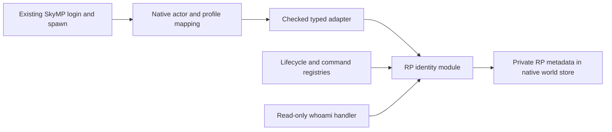

# Phase 2 recommended architecture and Phase 2.1 implementation status

Audit date: 2026-10-13 (Asia/Bangkok). Local baseline: `5397cd3bf4666c942f78193107881d8cf0ac2748` on `develop`; engine source: `2849e676fe008925384b26f34476e382a30bd877`. The Phase 2.0 audit itself authorized no implementation; the later explicit Phase 2.1 specification authorized the limited original foundation below. Related findings: [audit](OPEN_SOURCE_REUSE_AUDIT.md), [component matrix](COMPONENT_COMPATIBILITY_MATRIX.md), [license review](THIRD_PARTY_LICENSE_REVIEW.md).

## Current approved slice — Phase 2.1

Implemented original `rp-gamemode/`: a self-contained CommonJS entry, minimal checked native adapter with distinct ID types, dependency/lifecycle registry, command registry and one RP identity module. It uses eight native methods only and writes only `private.rp.v1.identity` on the existing actor. Native login/spawn and physical state remain authoritative. No event router, chat/UI transport, donor code, SQL, economy, launcher or security system was added.

One owned 1-second native online-actor observer verifies current actor/user/profile/GUID association. Namespaced schema-1 metadata is idempotent, preserves existing valid records, refuses unknown/corrupt data and isolates periodic errors by actor. Controlled cleanup and partial failure rollback are tested; hot reload is unsupported. `/whoami` is a read-only domain handler only, not an in-game command yet.

Independent build and 67/67 tests passed. Actual native copied-world metadata save/new-process reload passed with the same actor and unchanged native inventory/equipment/appearance/location; the unchanged server temp loader also passed. Absolute immutable bundle deployment changed only gamemodePath, preserving world/artifact hashes. The user confirmed pre-restart game-state checks/reconnect; actual logs/save verify the same actor/profile and RP metadata. Latest world backed up and actual development server restarted as PID20076 with unchanged config/13 world files/metadata and verified readiness. Post-restart gameplay/live identity observation remains NOT TESTED. No 50–100-player capacity claim.

Current topology:



The diagram describes server ownership only; no client command transport exists. Future module enable/disable flags and composed events remain design proposals, not implemented registry features. After manual Phase 2.1 acceptance, the next recommended separately approved slice is verifying input/output transport and exposing the existing whoami handler; full chat/economy remain later work. Exact sources/tests/deployment/rollback: [Phase 2.1 report](PHASE21_BUILD_REPORT.md), [plan](PHASE21_IMPLEMENTATION_PLAN.md), [RP README](../../rp-gamemode/README.md).

The remaining sections preserve the Phase 2.0 staged design. Future stages and donor reuse remain proposals; they must not be read as completed functionality.

## Recommendation

Preserve the current SkyMP server/client and native player world. Add a small TypeScript gamemode bundle using the existing `globalThis.mp` boundary. Adapt isolated registry/command concepts first, then one RP identity/chat slice. Do not deploy any complete donor gamemode or substitute its launcher, login, spawn, inventory mirror or database schema. Heavy RP offers the most useful current code, but its native integration and SQL state ownership require refactoring.

The user reports solo validation of character, inventory, equipment and position persistence now passed. Earlier reports awaiting item confirmation are historical checkpoints; this audit records the latest user statement, without claiming a new test run. Two-real-player coverage and old equipment/hit log warnings have not been independently retested in this audit.

## Options considered

| Approach | Benefit | Cost/risk | Decision |
| --- | --- | --- | --- |
| Deploy Heavy RP whole stack | Broad RP systems already represented in source | SQL location overwrite, inventory replay, native-call mismatch, large migration/flag/config surface; mock coverage is not compatibility | Reject this integration approach |
| Port Red House modules and frontend | Concrete commands/interactions and extensive old TS wrapper | 2021 wrappers, missing runtime globals/ESPM/UI assets, conflicting authority and legacy toolchain | Reference selected designs; no wholesale port |
| Small additive TS gamemode over current engine | Preserves the solo-validated state and allows one independently testable feature at a time | Need explicit typed adapter, event composition and UI transport verification | Recommended |

## Ownership rules

| State | Authority | Phase 2 policy |
| --- | --- | --- |
| Actor creation/profile-to-actor reuse | Existing `ts/systems/login.ts` and `spawn.ts` | Preserve login/GUID guards and spawn; RP module observes current actor |
| Inventory/equipment, appearance, position/cell | Native bindings, `MpChangeForm`, file save storage | Do not mirror SQL into these on login; never clear native inventory or reset position |
| RP name/bio/schema version | Namespaced actor metadata using native custom properties initially | Add `private.rp.v1.*` server data and separately defined, minimal visible properties if needed; do not expose credentials |
| Account identity | Existing profile identity; offline IDs only for development | `profileId` is not a trusted production account credential; no new auth system in initial slice |
| Session identity | Current connection slot/GUID plus actor lookup | Never treat userId, actorId and profileId as interchangeable |
| Future RP money/business ledger | Separate repository after an approved economy design | No database choice/install or schema migration in this audit; no inventory dual authority |

Native equipment is read-only through its existing property binding. Avoid an RP equipment setter invented from donor declarations. Engine world files stay in the existing `rp-world`, outside Git; no file migration or schema rewrite is proposed for the initial slice.

## Phase 2.0 proposed file layout — historical design

The audit proposed this broader layout. Phase 2.1 now implements only the adapter, registries and identity subset, with flat tests and explicit scripts; event-router/chat modules do not exist. Keep domain code separate from `skymp5-server`, `skymp5-client`, native source and dependency pins.

```text
rp-gamemode/
  package.json / tsconfig.json
  src/index.ts                 one explicit boot entry
  src/engine/mp-api.ts          small, verified public API declarations
  src/engine/adapter.ts         injected mp, typed IDs, contract checks
  src/core/module-registry.ts   ordered boot/teardown and failed-state cleanup
  src/core/command-registry.ts  normalized commands and explicit outcomes
  src/core/event-router.ts      one owner per used mp hook; composed listeners
  src/modules/identity/         RP metadata only, no actor creation
  src/modules/chat/             command/chat domain, transport separated
  tests/contracts/              exact API signatures and ID mapping
  tests/modules/                pure handlers with strict fakes
  tests/integration/            approved disposable native runtime tests
```

A separate packet/browser UI adapter is added only when the first user-visible slice needs it. Do not build jobs/economy/housing frameworks before a real consumer exists. Do not take Heavy RP's entire Papyrus catalogue: it is pinned to a different engine commit and its reflection call shape differs from ours.

## Engine contract verified from current source

| Contract | Source | Constraint for new code |
| --- | --- | --- |
| `makeProperty(name, options)` / `makeEventSource(name, body)` / `get` / `set` | `skymp5-server/cpp/addon/ScampServer.cpp` binding table; property bindings | Use actual option/value shapes; custom properties are persisted, visibility is separate |
| Native inventory property | `cpp/addon/property_bindings/InventoryBinding.cpp` | Returns an entries structure with native metadata; writes replace inventory. Initial RP code must not call that replacement path |
| Native equipment | `skymp5-server/cpp/addon/property_bindings/EquipmentBinding.cpp` and `skymp5-server/cpp/addon/property_bindings/EquipmentBinding.h` | Existing read getter, not a general writable domain snapshot |
| `getActorsByProfileId` and `getUserByActor` | `ScampServer.cpp`, `ts/systems/spawn.ts` | Resolve IDs through engine; never enumerate a fixed user/profile range |
| Built-in `onActivate` | `cpp/server_guest_lib/gamemode_events/ActivateEvent.cpp` | Argument order is reference then caster. Compare actual event class for every event used |
| Custom event argument prefix | `skymp5-server/cpp/server_guest_lib/gamemode_events/CustomEvent.cpp` | Server prepends the sender actor/ref ID; client must not choose authoritative actor identity |
| Papyrus call | `cpp/addon/ScampServer.cpp`, `PapyrusUtils.h`, `skymp5-server/cpp/server_guest_lib/script_classes/PapyrusObjectReference.cpp` | Actor/object self references use `{type:'form', desc:...}`; base item arguments use `{type:'espm', desc:...}`. A number is not a form object. This VM executes server-side; do not assume it calls arbitrary client game functions |
| `place` | `ScampServer.cpp` | Returns numeric form ID in our checkout, not donor `{desc}` declaration |
| `_sp3GetFunctionImplementation` | `ScampServer.cpp` | Native reads class/function from argument positions 1/2. This private API is unstable; initial slice should avoid it |
| `clear` | `ScampServer.cpp` | Resets gamemode API state; does not cancel arbitrary Node timers/listeners/pools |

A narrowed typed facade should expose only methods the approved slice uses. Include branded/nominal `ActorId`, `UserId`, `ProfileId` and stable `FormDesc` types. Validate conversion at boundaries; TS types alone do not validate network payloads.

## Loading, module lifecycle and event composition

The current wrapper in `skymp5-server/ts/index.ts` copies a gamemode file into an OS temp directory then requires it. Relative imports and ordinary `require('dotenv')`/`mysql2` lookup cannot be assumed to resolve from the original gamemode directory. Produce a single bundled CommonJS entry with no unexpected bare dependencies and explicit runtime paths for any later external resources. Retain upstream engine flags and builds; do not enable the unrelated token-gated `BUILD_GAMEMODE` downloader.

`BUILD_GAMEMODE=OFF` creates an empty `build/dist/server/gamemode.js` during builds. Phase 2.1 explicitly deploys a hash-named immutable bundle outside generated output and selects an absolute gamemodePath. After a native rebuild, inspect config/artifacts and verify the selected bundle again. No native build flag/downloader was changed.

Lifecycle states: registered, disabled, initializing, running, failed, stopping, stopped. Boot prerequisites first, stop in reverse order. On partial initialization failure remove owned commands/interactions/hooks and stop resources already opened; do not leave a failed module in the active set. A disabled flag and a failed initialization must be distinguishable. The Heavy RP registry has useful ordering/state tests but its command-registration failure path needs stronger cleanup.

For each actual native event, use one composed handler that preserves existing behavior and observes its synchronous cancellation contract. Native `GameModeEvent::Fire` checks listener outcomes; an async Promise is not an authoritative synchronous veto. Do not overwrite `mp.onActivate`, `onDeath` or `onLoginAttempt` from each module independently. The current offline login path does not invoke the online `onLoginAttempt` gate, so it is not a universal session hook.

Prefer explicit deployment restart over unproven hot reload. If reload is later approved, own timers, event listeners, registry singleton state and pools; native `clear()` alone is insufficient. No shutdown-flush guarantee is inferred from Ctrl+C.

## Minimal first user-visible slice

Start with RP name metadata and a read-only `/whoami` command, then one local RP chat channel. Keep actor creation and physical state unchanged. Transport must be proven through existing gamemode event-source/property/browser contracts on 1.6.1170, using approved paired client binaries. A command registry alone is not chat UI or authenticated dispatch.

Avoid importing Heavy RP's whitelist identity bootstrap: it writes SQL location and synchronizes a separate inventory model. Map current engine profile/actor to RP metadata without creating a new game character. Initially one current actor per profile follows existing baseline; multiple characters are a separate design because `Spawn` selects the first actor, not a donor SQL active-character row.

## Database/economy boundary for later phases

No external DB is required for the initial metadata/command slice. Native namespaced actor properties can hold small RP metadata and leverage the validated world store; make no claim about multi-record ACID transactions.

If economy is later approved, use a versioned ledger with stable character identity, integer minor units, unique idempotency keys and transactions. Compare Heavy RP SQL patterns but design against our ownership rules. A SQL COMMIT and asynchronous native world save do not share an atomic transaction. Require durable intents/outbox, explicit applied/confirmed/reconciled states and restart recovery before trading native items. Do not make native inventory the replaceable cache of SQL. Do not blindly retry AddItem after reconnect.

Migration plan must use an empty/disposable RP database first, inventory the donor schema and migration runner, preserve pre-migration backups and test rollback/recovery. MySQL/MariaDB DDL may commit outside the intended transaction; a transaction wrapper is not proof every migration is atomic. Never run donor migration scripts against current world files.

## Ranked staged acceptance gates

Estimates are engineer-days for one developer familiar with this checkout; include adaptation and targeted tests, exclude new art/content and two-PC logistics. They are planning ranges, not compatibility guarantees, and should not be summed across overlapping work.

| Order | Proposed scope | Effort | Required acceptance evidence |
| --- | --- | ---: | --- |
| 1 | Exact TS API facade + ID mapping | 1–2 days | Contract tests match native binding table; actor vs user vs profile confusion rejected; no runtime/native file change |
| 2 | Limited command/interaction descriptor reuse and lifecycle adaptation | 2–4 days | Unknown/duplicate command behavior explicit, async failure observable; failed boot cleans all resources; dependency cycle and double boot/stop/reload handled |
| 3 | RP identity + read-only command | 2–4 days | Same native actor/profile reused; RP name survives reconnect/restart; inventory/equipment/position unchanged; no donor SQL writes |
| 4 | One RP chat channel/command transport | 3–5 days | Two real clients exchange messages with correct identity/range; duplicate events absent; browser focus and Thai text display checked; reconnect works |
| 5 | One interaction UI consumer | 3–6 days | Sender/target mapping and range tested; unsupported targets fail explicitly; cancel/close restores controls; actual activation hook order verified |
| 6 | SQL ledger prototype, then economy/native item reconciliation | 8–15+ days | Replay/concurrent spends/restart between intent, DB commit and native mutation; no dup/loss; migrations on disposable DB; real inventory metadata retained |
| Later | Jobs/crafting, then trading/housing | Separately estimated in matrix | Use accepted identity, ledger and interaction APIs; two-client/restart tests before enabling |

## Regression/rollback gate

Before approving any deployment, preserve local `rp-world` plus relevant configuration securely, record current source/DLL/JS/runtime fingerprints and a control character's inventory/equipment/location. Use a disposable native test runtime; the repository CTest integration runner deletes its fixture world and must not touch development persistence. Pure/mocked tests complement real native/client tests; they cannot substitute for them.

For each approved slice: source contract tests, targeted native fixture test, real one-client reconnect/restart and then two-client behavior. Acceptance requires no new actor duplication, item loss/duplication, equipment reset or position reset. Record existing log anomalies separately and investigate any new regression rather than labeling process liveness as success. Roll back the bundle/config to baseline while retaining world backups; deleting the player world is not rollback.

## Approval boundary

The user's Phase 2.1 request approved the limited original adapter/registries/private identity/read-only handler and safe deployment. That slice is implemented and awaiting manual acceptance; no donor copying was approved or performed. Any next slice requires a separate request after acceptance. No package download, schema migration, game/client change, SQL, chat UI, anti-cheat or launcher is authorized by this implementation. No automatic commits or Phase 2.2 work.
